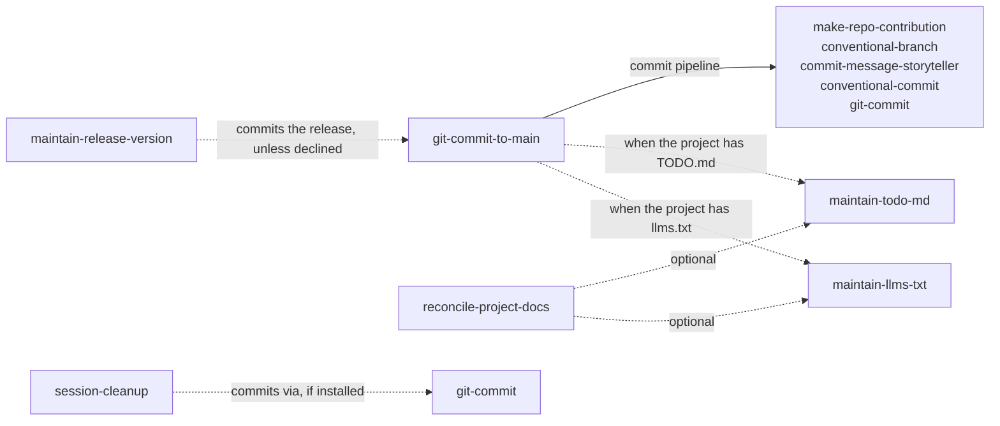

<div align="center">

# 🧰 Agent Skills

**Reusable workflow skills for AI coding agents — from dev environment setup to clean commits, tidy docs, and a safe session wrap-up.**

[](./CHANGELOG.md)
[](#-skill-catalog)
[](./LICENSE)
[](https://www.conventionalcommits.org)

Works with **Claude Code** · **Codex** · **Gemini CLI** · **Cursor** · and other agents that load `SKILL.md` skills

**English** · [简体中文](./README.zh-CN.md)

</div>

---

## ✨ Highlights

- 🔒 **Local-first and safe by default** — the Git and cleanup workflows never push or open pull requests, `session-cleanup` leaves session records alone, and most skills spell out what they will not touch.
- 🧩 **Built to work together** — `git-commit-to-main` runs the `llms.txt` and `TODO.md` maintenance skills when a project uses them, and `maintain-release-version` hands its finished release to it for committing.
- ✅ **Checked by scripts** — bundled Python validators check `llms.txt`, `TODO.md`, and release versions, so the agent does not just guess.
- 🪶 **Small context cost** — each skill loads only the reference files a task needs.

## 📦 Skill Catalog

### 🛠️ Dev Environment

| Skill | What it does |
|---|---|
| [**mise-guide**](./mise-guide/) | Teaches agents how to use [mise](https://mise.jdx.dev) — the polyglot dev environment manager — for tool versions, per-project env vars, and tasks. Confirms project or global scope with the user before it installs or pins a tool. |

### 🔀 Git & Release

| Skill | What it does |
|---|---|
| [**git-commit-to-main**](./git-commit-to-main/) | Local-only workflow: runs applicable project maintenance, splits changes into Conventional Commits on a Conventional Branch, then fast-forwards into `main` and deletes the branch. Never pushes. |
| [**maintain-release-version**](./maintain-release-version/) | Keeps one project version in `VERSION`, `CHANGELOG.md`, and `package.json` files. Works out the next SemVer bump from Conventional Commits, commit by commit. |

### 📚 Docs & Knowledge

| Skill | What it does |
|---|---|
| [**reconcile-project-docs**](./reconcile-project-docs/) | Brings project docs in line with the current conversation and repository: fixes contradictions, removes outdated text, and keeps lessons worth saving. |
| [**distill-session-history**](./distill-session-history/) | Reviews recent agent session history, distills recurring problems and their fixes, and proposes lasting doc updates. Session excerpts are redacted by default. |
| [**maintain-llms-txt**](./maintain-llms-txt/) | Maintains and validates directory-level [`llms.txt`](https://llmstxt.org) navigation files: finds affected files, fills a template, and checks links and coverage. |
| [**maintain-todo-md**](./maintain-todo-md/) | Maintains and validates a git-friendly `TODO.md` with `Next` / `Backlog` / `Blocked` / `Done ✓` sections. |

### 🧹 Session Lifecycle

| Skill | What it does |
|---|---|
| [**session-cleanup**](./session-cleanup/) | Closes out a session: finishes loose ends, commits changes the session made, moves its throwaway files to the Trash, reports how much space they take, and says whether it is safe to close. Never touches session records. |

## 🔗 How the Skills Fit Together



Solid arrows are fixed steps; dashed arrows run only when the condition applies. `distill-session-history` runs on its own, when you ask for a cross-session review.

> [!NOTE]
> `git-commit-to-main` also uses these skills from [github/awesome-copilot](https://github.com/github/awesome-copilot/tree/main/skills): `make-repo-contribution`, `conventional-branch`, `commit-message-storyteller`, `conventional-commit`, and `git-commit`. Install them as well to run the full workflow.

## 🚀 Installation

Install skills from this repo with the [skills](https://github.com/vercel-labs/skills) CLI (requires Node.js 22.20 or later). It asks which skills to install:

```bash
npx skills add https://github.com/kinoward/agent-skills -g
```

Or install a single skill:

```bash
npx skills add https://github.com/kinoward/agent-skills --skill mise-guide -g
```

> [!TIP]
> `-g` installs at user level, so the skills work in every project; without it they go into the current project. Several skills run their bundled scripts from `${AGENTS_SKILLS_DIR:-$HOME/.agents/skills}/<skill-name>/scripts/`. If your skills live somewhere else, set `AGENTS_SKILLS_DIR` to that folder.

### Requirements

| Needed by | Requirement |
|---|---|
| Git workflow skills and `session-cleanup` | `git` |
| Bundled validators and scripts | Python 3.7+ (standard library only, no third-party packages) |
| `mise-guide` | [`mise`](https://mise.jdx.dev) (the skill can install it) |
| `session-cleanup` | A `trash` or `gio trash` command for the system Trash; otherwise files move to `~/.agents-session-trash/<timestamp>/` |
| `distill-session-history` | Codex session JSONL files from `${CODEX_HOME:-~/.codex}/sessions` and `archived_sessions`, or a path passed with `--source` |

## 🗂️ Repository Layout

Every skill has a `SKILL.md`. The other folders are optional and vary by skill.

```text
agent-skills/
├── <skill-name>/
│   ├── SKILL.md        # Skill instructions and trigger description
│   ├── agents/         # Agent UI metadata (openai.yaml)
│   ├── references/     # Detailed guides, loaded only when needed
│   ├── scripts/        # Bundled validators and helpers
│   ├── assets/         # Templates
│   └── evals/          # Evaluation prompts
├── CHANGELOG.md        # Release history (English)
└── CHANGELOG.zh-CN.md  # Release history (简体中文)
```

## 📝 Changelog

See [CHANGELOG.md](./CHANGELOG.md) for the release history ([简体中文](./CHANGELOG.zh-CN.md)).

## 📄 License

[MIT](./LICENSE) © kinoward
