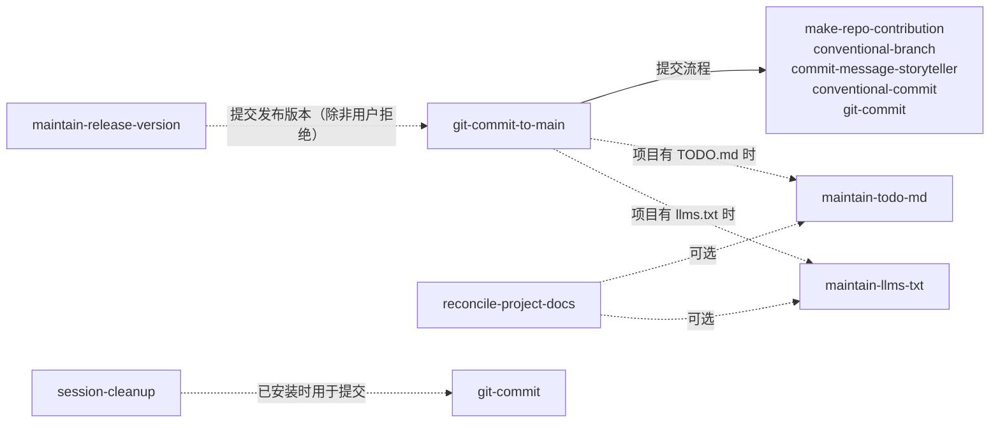

<div align="center">

# 🧰 Agent Skills

**面向 AI 编程 agent 的可复用工作流 skill——从开发环境配置到规范提交、文档整理，再到安全的会话收尾。**

[](./CHANGELOG.zh-CN.md)
[](#-skill-目录)
[](./LICENSE)
[](https://www.conventionalcommits.org)

适用于 **Claude Code** · **Codex** · **Gemini CLI** · **Cursor** · 以及其他可加载 `SKILL.md` skill 的 agent

[English](./README.md) · **简体中文**

</div>

---

## ✨ 亮点

- 🔒 **本地优先，默认安全**——Git 和清理类工作流绝不推送代码或创建 pull request，`session-cleanup` 不会动会话记录，多数 skill 也会明确说明自己不会触碰什么。
- 🧩 **协同工作**——项目使用 `llms.txt` 和 `TODO.md` 时，`git-commit-to-main` 会先运行对应的维护类 skill；`maintain-release-version` 完成发布版本后，则交给它来提交。
- ✅ **由脚本校验**——内置的 Python 校验脚本会检查 `llms.txt`、`TODO.md` 和发布版本，agent 不必只靠猜测。
- 🪶 **上下文开销小**——每个 skill 只加载当前任务所需的参考文件。

## 📦 Skill 目录

### 🛠️ 开发环境

| Skill | 功能 |
|---|---|
| [**mise-guide**](./mise-guide/) | 指导 agent 使用 [mise](https://mise.jdx.dev)（多语言开发环境管理器）来管理工具版本、项目级环境变量和任务。安装或固定工具版本之前，会先与用户确认是项目级还是全局范围。 |

### 🔀 Git 与发布

| Skill | 功能 |
|---|---|
| [**git-commit-to-main**](./git-commit-to-main/) | 纯本地工作流：先执行适用的项目维护，再在 Conventional Branch 上把改动拆分为多个 Conventional Commits，最后 fast-forward 合并到 `main` 并删除该分支。绝不推送。 |
| [**maintain-release-version**](./maintain-release-version/) | 在 `VERSION`、`CHANGELOG.md` 和 `package.json` 文件中统一维护同一个项目版本，并根据 Conventional Commits 逐个提交推算下一个 SemVer 版本号。 |

### 📚 文档与知识

| Skill | 功能 |
|---|---|
| [**reconcile-project-docs**](./reconcile-project-docs/) | 让项目文档与当前对话和仓库状态保持一致：修正相互矛盾的描述，删除过时内容，并保留值得沉淀的经验。 |
| [**distill-session-history**](./distill-session-history/) | 回顾近期的 agent 会话历史，提炼反复出现的问题及其解决方法，并提出可长期保留的文档更新建议。会话摘录默认会脱敏。 |
| [**maintain-llms-txt**](./maintain-llms-txt/) | 维护并校验目录级的 [`llms.txt`](https://llmstxt.org) 导航文件：找出受影响的文件，按模板填写，并检查链接与覆盖范围。 |
| [**maintain-todo-md**](./maintain-todo-md/) | 维护并校验对 git 友好的 `TODO.md`，包含 `Next` / `Backlog` / `Blocked` / `Done ✓` 几个分区。 |

### 🧹 会话生命周期

| Skill | 功能 |
|---|---|
| [**session-cleanup**](./session-cleanup/) | 为会话收尾：完成遗留事项，提交本会话产生的改动，把临时文件移入废纸篓，报告这些文件占用的空间，并告知是否可以安全关闭。绝不触碰会话记录。 |

## 🔗 Skill 如何协同工作



实线箭头表示固定步骤，虚线箭头仅在满足条件时才会执行。`distill-session-history` 独立运行，在你要求跨会话回顾时使用。

> [!NOTE]
> `git-commit-to-main` 还会用到 [github/awesome-copilot](https://github.com/github/awesome-copilot/tree/main/skills) 中的这些 skill：`make-repo-contribution`、`conventional-branch`、`commit-message-storyteller`、`conventional-commit` 和 `git-commit`。要运行完整工作流，请一并安装它们。

## 🚀 安装

使用 [skills](https://github.com/vercel-labs/skills) CLI 安装本仓库中的 skill（需要 Node.js 22.20 或更高版本）。它会询问要安装哪些 skill：

```bash
npx skills add https://github.com/kinoward/agent-skills -g
```

或者只安装单个 skill：

```bash
npx skills add https://github.com/kinoward/agent-skills --skill mise-guide -g
```

> [!TIP]
> `-g` 表示安装到用户级，这样 skill 在每个项目中都可用；不加该参数则会安装到当前项目。部分 skill 会从 `${AGENTS_SKILLS_DIR:-$HOME/.agents/skills}/<skill-name>/scripts/` 运行内置脚本。如果你的 skill 放在其他位置，请将 `AGENTS_SKILLS_DIR` 设置为该文件夹。

### 环境要求

| 适用对象 | 要求 |
|---|---|
| Git 工作流 skill 和 `session-cleanup` | `git` |
| 内置的校验脚本和工具脚本 | Python 3.7+（仅使用标准库，无需第三方包） |
| `mise-guide` | [`mise`](https://mise.jdx.dev)（skill 可代为安装） |
| `session-cleanup` | 用于系统废纸篓（回收站）的 `trash` 或 `gio trash` 命令；否则文件会移动到 `~/.agents-session-trash/<timestamp>/` |
| `distill-session-history` | `${CODEX_HOME:-~/.codex}/sessions` 和 `archived_sessions` 下的 Codex 会话 JSONL 文件，或通过 `--source` 传入的路径 |

## 🗂️ 仓库结构

每个 skill 都有一个 `SKILL.md`，其余文件夹为可选项，因 skill 而异。

```text
agent-skills/
├── <skill-name>/
│   ├── SKILL.md        # Skill 说明与触发描述
│   ├── agents/         # Agent UI 元数据（openai.yaml）
│   ├── references/     # 详细指南，仅在需要时加载
│   ├── scripts/        # 内置的校验脚本和辅助脚本
│   ├── assets/         # 模板
│   └── evals/          # 评测提示词
├── CHANGELOG.md        # 版本历史（English）
└── CHANGELOG.zh-CN.md  # 版本历史（简体中文）
```

## 📝 更新日志

版本历史请见 [CHANGELOG.zh-CN.md](./CHANGELOG.zh-CN.md)（[English](./CHANGELOG.md)）。

## 📄 许可证

[MIT](./LICENSE) © kinoward
